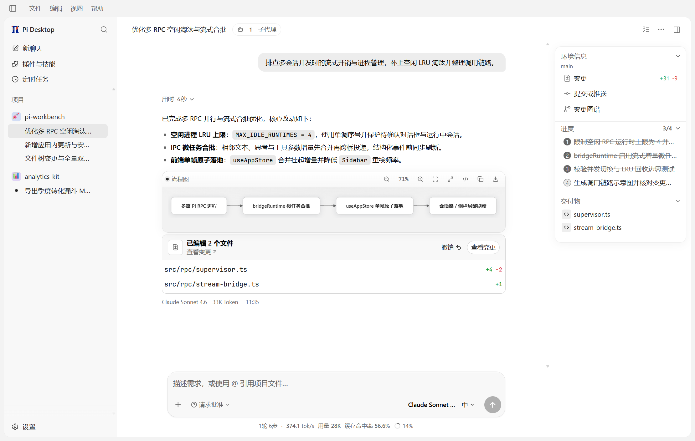
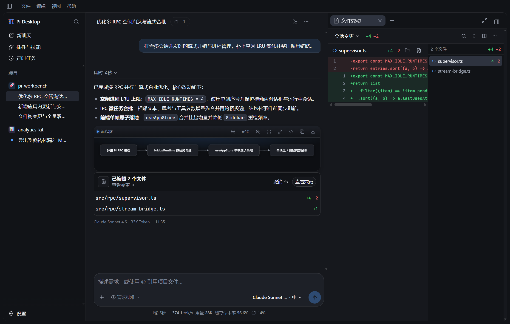
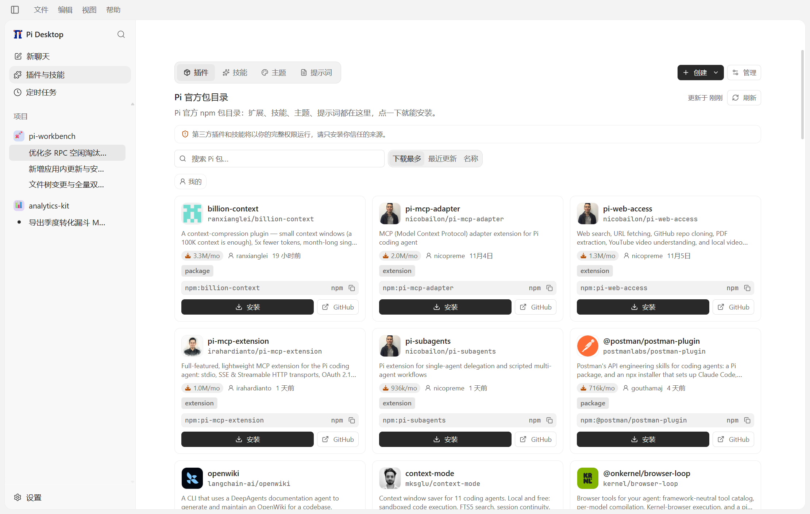
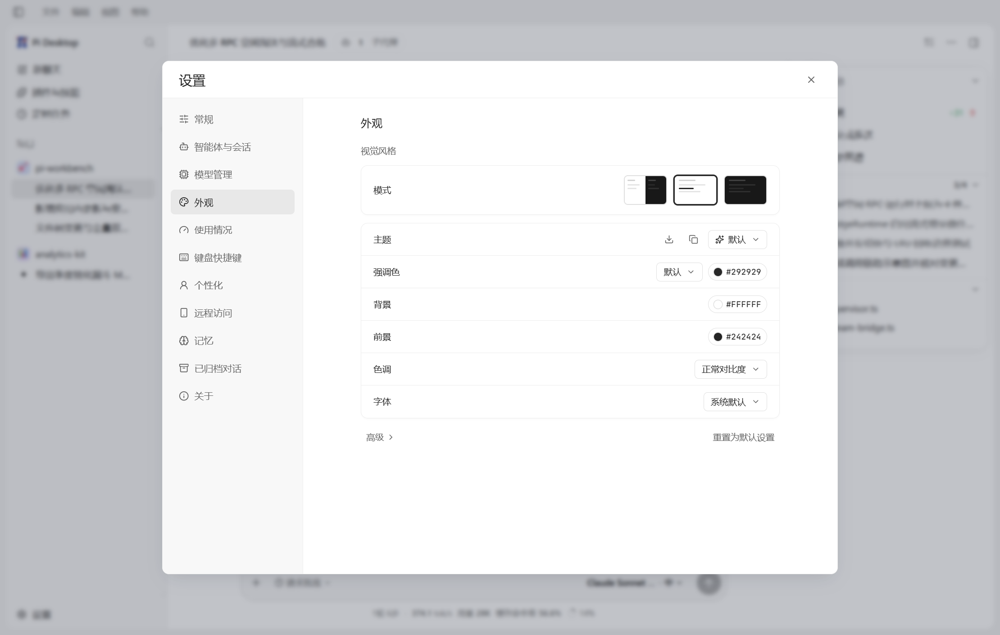

<div align="center">


# Pi Desktop

**为 Pi coding agent 打造的桌面工作台**

在一个窗口里完成对话、代码修改、Git 审查与终端操作。

[](https://github.com/facron2004/pi-desktop/releases/latest) [](https://github.com/facron2004/pi-desktop/releases/latest) [](https://github.com/earendil-works/pi) [](package.json) [](package.json) [](package.json) [](LICENSE)

[下载](https://github.com/facron2004/pi-desktop/releases/latest) · [快速上手](#快速上手) · [使用指南](docs/user-guide.md) · [扩展市场说明](docs/marketplace.md) · [Mermaid 图表插件](docs/mermaid-plugin.md) · [PM 插件套件](docs/pm-plugin-suite.md) · [开发文档](docs/development.md) · [更新日志](CHANGELOG.md)

</div>



<p align="center"><sub>实际应用截图（浅色三栏工作台、任务进度轨道、Mermaid 图表与代码改动摘要）；对话与项目内容为演示数据。</sub></p>

## 简介

Pi Desktop 是 [Pi coding agent](https://github.com/earendil-works/pi) 的独立 Electron 图形客户端，通过 RPC 协议驱动 Pi。它在一个窗口内整合对话信息流、任务轨道、文件与差异审查、内置终端以及插件与自动化工作台，同时完整保留 Pi 的模型、工具、会话树、技能与扩展生态。

## 核心功能

| 能力 | 说明 |
| --- | --- |
| 会话与项目 | 按项目管理对话（支持自定义 Emoji 图标与配色），检索、重命名、置顶、导出 HTML、浏览会话树并分支；多会话可在后台并行运行，空转 RPC 进程自动 LRU 回收。 |
| 对话信息流 | 微任务合批与单帧原子流式渲染，保留独立滚动记忆、子智能体标题栏状态入口，以及轮次速度、Token 缓存命中与上下文环形指示器。 |
| Git 工作流 | 查看分支、工作区状态、变更/全量双索引文件树与逐文件 Diff 对比，暂存、提交、回退改动，并管理分支与 worktree。 |
| 工作区工具 | 文件名与全文搜索、语法高亮、代码变更审查、图片查看与输入框生图、内置浏览器视图，以及支持 PowerShell、CMD、Git Bash 和 WSL 的集成终端。 |
| 模型与任务 | 配置提供商和模型，选择权限与推理强度；支持普通、Goal、Plan 和 Subagent 模式，右侧任务轨道实时同步分支变更、计划进度与交付物。 |
| 扩展与官方市场 | 接入 `pi.dev/packages` 官方 npm 包目录，支持按下载量/更新时间搜索筛选、实时查看安装输出、创建本地资源并管理已安装插件、技能、主题与提示词。 |
| Mermaid 图表 | 对话里的 Mermaid 代码块直接渲染为可缩放、可全屏、可导出 SVG 的图表；输入框提供流程图、泳道图、时序图等 13 个产品经理模板，并内置作图规范与校验插件。 |
| 产品经理插件套件 | 5 个可独立安装的 PM 插件：PRD / 用户故事 / 优先级 / 实验、竞品情报、用户反馈聚类、定价与包装、Jira / Linear / Notion / 飞书等 MCP 连接配方。 |
| 自动化、IM 与远程 | 设置一次性或周期定时任务；接入飞书（官方长连接）与微信（wechatbot-webhook 桥）频道，双向驱动对话并在完成、需确认时推送；在可信局域网中配对手机远程查看、发送、停止、应答确认与新建对话；Windows 安装版支持应用内检测 GitHub Release 并完成 SHA-256 校验自动安装。 |
| 记忆、快捷键与外观 | 按项目保存可管理的会话记忆；支持自定义与检索应用快捷键、自动标题、主题预设、强调色、字体及缩放设置。 |

<details>
<summary>更多界面：深色工作台与变更审查、扩展市场、外观设置</summary>

### 深色工作台与文件变动审查



### 插件与技能市场（Pi 官方包目录）



### 外观设置



</details>

## 下载与安装

当前发布版本为 **v0.11.23**，内置 **Pi 1.6.0**。安装版与免安装版均无需额外安装 Node.js 或 Pi CLI。

| 平台 | 下载 |
| --- | --- |
| Windows x64 安装版 | [下载 EXE](https://github.com/facron2004/pi-desktop/releases/download/v0.11.23/Pi.Desktop-0.11.23-x64.exe) |
| Windows ARM64 安装版 | [下载 EXE](https://github.com/facron2004/pi-desktop/releases/download/v0.11.23/Pi.Desktop-0.11.23-arm64.exe) |
| Windows x64 / ARM64 通用安装版 | [下载 EXE](https://github.com/facron2004/pi-desktop/releases/download/v0.11.23/Pi.Desktop-0.11.23.exe) |
| Windows x64 免安装版 | [下载 ZIP](https://github.com/facron2004/pi-desktop/releases/download/v0.11.23/Pi.Desktop-0.11.23-portable-x64.zip) |

免安装版解压后运行 `Pi Desktop.exe`。文件校验值见 [SHA256SUMS.txt](https://github.com/facron2004/pi-desktop/releases/download/v0.11.23/SHA256SUMS.txt)，版本说明见 [v0.11.23 更新说明](docs/releases/v0.11.23.md)。

## 快速上手

1. 启动应用，打开希望 Pi 处理的项目文件夹。
2. 在「设置 → 模型管理」添加提供商，填写 Base URL 和 API Key，拉取模型、检测连通性后保存。已有的 Pi 登录或配置可复用，详见 [认证说明](docs/user-guide.md#模型与认证)。
3. 输入任务，或用 `@` 引用项目文件，发送后查看回复与工具过程。
4. 在工具面板查看文件和 Git 更改，确认后再提交需要保留的修改。

重启应用会恢复上次的项目并进入新聊天；点击侧栏中的历史会话后才会继续该会话。Pi 使用当前用户的权限执行操作，项目配置与扩展的加载可在设置中控制。

## 常用快捷键

| 快捷键 | 操作 |
| --- | --- |
| `Ctrl+N` | 新聊天 |
| `Ctrl+Shift+P` | 命令启动器 |
| `Ctrl+F` | 搜索当前会话 |
| `Ctrl+P` / `Ctrl+T` | 切换模型 / 推理强度 |
| `` Ctrl+` `` | 打开终端 |
| `Ctrl+/` | 查看完整快捷键列表 |

更多操作见 [使用指南](docs/user-guide.md)。

## 本地开发

需要 **Node.js 22.19+** 与 npm。

```bash
git clone https://github.com/facron2004/pi-desktop.git
cd pi-desktop
npm ci
npm run dev
```

构建、测试、打包与协议约定见 [开发文档](docs/development.md)，提交修改前请阅读 [AGENTS.md](AGENTS.md)。

## 反馈与许可

遇到问题可提交 [Issue](https://github.com/facron2004/pi-desktop/issues)，并附应用版本、操作系统、复现步骤与已脱敏的截图或日志。

项目采用 [MIT 许可证](LICENSE)。感谢 [Pi](https://github.com/earendil-works/pi) 及其贡献者；Pi Desktop 是独立的社区客户端。
