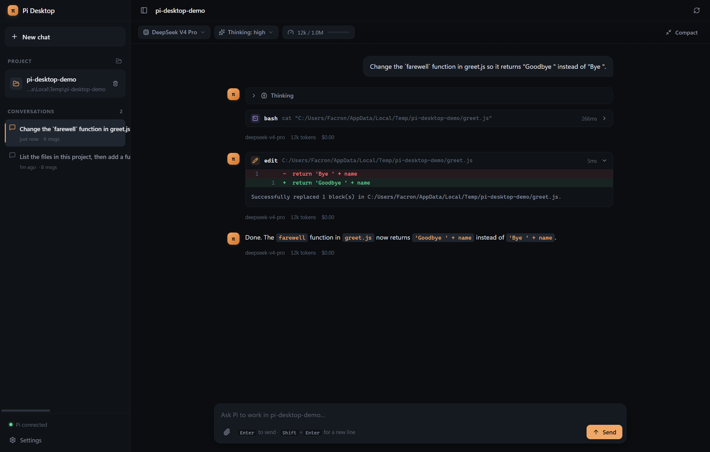

# Pi Desktop

A native desktop GUI for the [Pi coding agent](https://github.com/earendil-works/pi) —
the same agent that powers the `pi` CLI, wrapped in a window that feels like Codex or
Claude Desktop.



*Real run: Pi reads a file, edits it, and the diff renders inline.*

## What it does

- **Chat with Pi in a real project folder.** Pick a workspace, and Pi runs there with
  your own permissions — reading files, running commands, editing code.
- **Streaming conversation.** Assistant text, reasoning ("thinking") blocks, tool calls
  and tool output all stream in live, with a caret marking the end of the reply. The
  reasoning opens itself while the model is still thinking and folds away when the
  answer arrives.
- **Tool cards with diffs.** Every tool call is a collapsible card. File edits render
  as a line diff, so you can see exactly what changed. Long stretches of untouched
  lines collapse into a single row you can open, a run of the same call folds into one
  card, and a command or a path can be handed back to the composer. The file a card
  read or wrote is shown as highlighted code with line numbers.
- **Code blocks that answer back.** A snippet gets a header with its language, a copy
  button and an "Ask" button that drops the snippet into the composer, ready for a
  question about it.
- **Project inspector.** A docked panel with two tabs: **Changes** lists every file the
  agent edited or created in this session, with the line counts of each change, and
  **Files** is a project tree you can search by name and read in place, with syntax
  highlighting and line numbers. Diffs can be shown unified or side by side, and the
  panel can be dragged to any width. A line number in a diff opens the file at that
  line, so a change can be followed into the code around it. The sidebar and the panel
  keep the width they were given.
- **Extension dialogs.** When a Pi extension asks you a question — pick one, confirm,
  type a value, edit a block of text — the desktop app shows the dialog and answers Pi
  for you. Extensions can also push status lines, widgets and notifications.
- **Session history.** Pi persists every conversation to disk; the sidebar lists them
  per project, filters them, renames them and exports them as HTML. The empty state
  offers the last conversations of the project, so a run can be picked up again
  without walking through the sidebar. A conversation can be pinned, and pinned ones
  float to the top of the sidebar no matter which project they belong to. The app
  also reopens the conversation that was open last, so a restart does not lose the
  thread of the work.
- **Several projects at once.** The sidebar lists every project that was opened. Clicking
  one runs Pi there, `Ctrl+1` … `Ctrl+9` jump to the n-th project, and the title bar
  says which project the open conversation belongs to.
- **Branch from any prompt.** Every message you sent is a branch point. "Branch" opens a
  new conversation that keeps the earlier history and hands the prompt back to the
  composer, so you can try a different approach without losing the run-up. The copy
  button in the title bar duplicates the whole conversation instead.
- **Search the conversation.** `Ctrl+F` finds every mention of a word in the thread and
  walks through the hits. `Alt+↑` and `Alt+↓` walk the turns themselves, and a running
  turn counts its own seconds.
- **Command palette.** Type `/` in the composer to reach Pi's own commands — skills,
  prompt templates and extension commands — and the ones the desktop app adds:
  `/export`, `/duplicate`, `/branch`, `/compact`, `/copy`, `/changes`, `/files`, `/new`.
- **Model and effort control.** Switch model and reasoning level mid-conversation. The
  context meter in the top bar opens a session panel with the token breakdown, the cost
  so far and the message counts, and it can compact the context — with or without
  instructions for the summary.
- **Steering.** While Pi is working you can steer it ("stop and do this instead") or
  queue a follow-up for when it finishes.
- **Retries you can see.** When a request fails with a transient error, Pi retries it on its
  own. The app says so — with the attempt, the reason and a button that stops the retry
  instead of waiting it out.
- **Keyboard-first.** `Ctrl+N` new chat, `Ctrl+B` sidebar, `Ctrl+K` focus the composer,
  `Ctrl+F` search the conversation, `Ctrl+1`…`Ctrl+9` switch project, `Alt+↑`/`Alt+↓` walk
  the turns, `↑` recalls earlier prompts, `Esc` stops a run. `Ctrl+/` lists every
  shortcut. The app also follows the system's "reduce motion" setting.

## How it talks to Pi

Pi exposes an [RPC mode](https://github.com/earendil-works/pi/blob/main/packages/coding-agent/docs/rpc.md):
the CLI is started as a long-lived child process and driven with JSON Lines over
stdin/stdout.

```
┌──────────────────┐   JSONL over stdio   ┌───────────────────────────┐
│  Pi Desktop      │ ───────────────────► │  pi --mode rpc            │
│  (Electron)      │ ◄─────────────────── │  (child process)          │
└──────────────────┘   responses+events   └───────────────────────────┘
```

The desktop app is a protocol client, not a re-implementation of the agent. That
means every Pi feature — providers, models, thinking levels, compaction, steering,
sessions, skills, prompt templates — works the same way it does in the terminal.

Pi can also ask the client for interaction through its
[extension UI protocol](https://github.com/earendil-works/pi/blob/main/packages/coding-agent/docs/rpc-extension-ui.md).
`select`, `confirm`, `input` and `editor` pause the agent until the user answers, so
the app renders them as dialogs and replies with an `extension_ui_response` carrying
Pi's own request id. `notify`, `setStatus`, `setWidget`, `setTitle` and
`set_editor_text` are fire-and-forget and become a status strip, a widget above the
composer, a window title or a prefilled prompt.

The protocol implementation lives in [`src/main/pi/rpc-client.ts`](src/main/pi/rpc-client.ts).
It follows the framing rules from Pi's docs exactly:

- one JSON object per record, terminated by `\n`
- records are split on **LF only** — `U+2028`/`U+2029` are valid inside JSON strings,
  so Node's `readline` is deliberately not used
- an optional `\r` before the `\n` is stripped
- stdout carries protocol records only; stderr carries diagnostics
- stdin writes honour backpressure

Commands are correlated by `id`, and session events are folded into a normalised
thread model in [`src/renderer/src/lib/thread.ts`](src/renderer/src/lib/thread.ts).

Pi keeps a session as a tree: a conversation can branch, and a branch keeps the
history that came before it. The app drives that through `get_fork_messages` and
`fork`, so a prompt can become the start of a new conversation without the earlier
turns being lost.

## Requirements

- Windows, macOS or Linux
- Node.js 22.19+ (for development)
- A Pi provider login. Run `pi` once and use `/login`, or set an API key.

Pi itself is bundled as a dependency, so no separate install is required. If you
already have a Pi checkout, point **Settings → Pi CLI path** at it.

## Development

```bash
npm install
npm run dev        # run with hot reload
npm run build      # type-safe production build into out/
npm run typecheck  # tsc for main, preload and renderer
npm run icon       # regenerate build/icon.png
npm run dist       # package installers into release/
```

A protocol smoke test that spawns the bundled CLI and exercises the RPC commands:

```bash
node scripts/rpc-smoke.mjs "C:/path/to/project"
```

And one that checks the extension UI round trip — a temporary extension asks for every
kind of dialog, and the answers have to reach it:

```bash
node scripts/rpc-ui-smoke.mjs
```

Screenshots live in [`docs/shots/`](docs/shots): the welcome screen, a real
conversation with an inline diff, the light theme, and the app mid-run.

## Architecture

```
src/
├── main/                 Electron main process
│   ├── pi/
│   │   ├── locate.ts     finds the Pi CLI (bundled → custom → PATH)
│   │   ├── rpc-client.ts JSONL framing, command correlation, event fan-out
│   │   ├── runtime.ts    owns the Pi child process for the active workspace
│   │   └── cli.ts        one-shot CLI calls (version, auth check)
│   ├── ipc.ts            typed IPC surface
│   ├── sessions.ts       reads Pi's session files from ~/.pi/agent/sessions
│   ├── settings.ts       persisted app settings
│   └── screenshot.ts     dev-only window capture
├── preload/index.ts      contextBridge API (contextIsolation, no nodeIntegration)
├── shared/types.ts       protocol and domain types shared by all three layers
└── renderer/src/         React UI
    ├── components/       thread, tool cards, diffs, composer, settings, panels
    ├── lib/thread.ts     Pi session event → UI thread reducer
    ├── lib/changes.ts    tool calls → changed-files review
    ├── lib/diff-fold.ts  line diff → folded, expandable diff rows
    ├── lib/projects.ts   registered projects + the conversations of each
    ├── lib/search.ts     in-conversation search
    ├── lib/highlight.ts  syntax highlighting, grammars loaded on demand
    └── store/            zustand store
```

### Security

- The renderer has no Node.js access: `contextIsolation: true`, `nodeIntegration: false`.
- The only bridge surface is the typed `window.pi` API in [`src/shared/types.ts`](src/shared/types.ts).
- Pi runs as a separate process with your own permissions, exactly like the CLI.

## Credits

Built on [Pi](https://github.com/earendil-works/pi) by Mario Zechner and contributors
(MIT). This GUI is an independent client of Pi's RPC protocol.

## License

MIT
