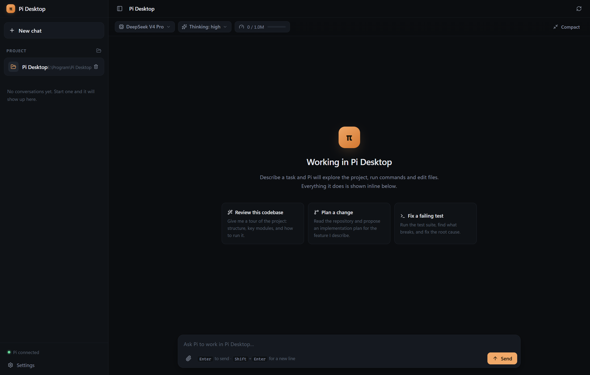

# Pi Desktop

A native desktop GUI for the [Pi coding agent](https://github.com/earendil-works/pi) —
the same agent that powers the `pi` CLI, wrapped in a window that feels like Codex or
Claude Desktop.



## What it does

- **Chat with Pi in a real project folder.** Pick a workspace, and Pi runs there with
  your own permissions — reading files, running commands, editing code.
- **Streaming conversation.** Assistant text, reasoning ("thinking") blocks, tool calls
  and tool output all stream in live.
- **Tool cards with diffs.** Every tool call is a collapsible card. File edits render
  as a line diff, so you can see exactly what changed.
- **Session history.** Pi persists every conversation to disk; the sidebar lists them
  per project and you can jump back in at any time.
- **Model and effort control.** Switch model and reasoning level mid-conversation, and
  watch the context window fill up.
- **Steering.** While Pi is working you can steer it ("stop and do this instead") or
  queue a follow-up for when it finishes.

## How it talks to Pi

Pi exposes an [RPC mode](https://github.com/earendil-works/pi/blob/main/packages/coding-agent/docs/rpc.md):
the CLI is started as a long-lived child process and driven with JSON Lines over
stdin/stdout.

```
┌──────────────────┐   JSONL over stdio   ┌───────────────────────────┐
│  Pi Desktop      │ ───────────────────► │  pi --mode rpc            │
│  (Electron)      │ ◄─────────────────── │  (child process)          │
└──────────────────┘   responses+events   └───────────────────────────┘
```

The desktop app is a protocol client, not a re-implementation of the agent. That
means every Pi feature — providers, models, thinking levels, compaction, steering,
sessions, skills, prompt templates — works the same way it does in the terminal.

The protocol implementation lives in [`src/main/pi/rpc-client.ts`](src/main/pi/rpc-client.ts).
It follows the framing rules from Pi's docs exactly:

- one JSON object per record, terminated by `\n`
- records are split on **LF only** — `U+2028`/`U+2029` are valid inside JSON strings,
  so Node's `readline` is deliberately not used
- an optional `\r` before the `\n` is stripped
- stdout carries protocol records only; stderr carries diagnostics
- stdin writes honour backpressure

Commands are correlated by `id`, and session events are folded into a normalised
thread model in [`src/renderer/src/lib/thread.ts`](src/renderer/src/lib/thread.ts).

## Requirements

- Windows, macOS or Linux
- Node.js 22.19+ (for development)
- A Pi provider login. Run `pi` once and use `/login`, or set an API key.

Pi itself is bundled as a dependency, so no separate install is required. If you
already have a Pi checkout, point **Settings → Pi CLI path** at it.

## Development

```bash
npm install
npm run dev        # run with hot reload
npm run build      # type-safe production build into out/
npm run typecheck  # tsc for main, preload and renderer
npm run dist       # package installers into release/
```

A protocol smoke test that spawns the bundled CLI and exercises the RPC commands:

```bash
node scripts/rpc-smoke.mjs "C:/path/to/project"
```

## Architecture

```
src/
├── main/                 Electron main process
│   ├── pi/
│   │   ├── locate.ts     finds the Pi CLI (bundled → custom → PATH)
│   │   ├── rpc-client.ts JSONL framing, command correlation, event fan-out
│   │   ├── runtime.ts    owns the Pi child process for the active workspace
│   │   └── cli.ts        one-shot CLI calls (version, auth check)
│   ├── ipc.ts            typed IPC surface
│   ├── sessions.ts       reads Pi's session files from ~/.pi/agent/sessions
│   ├── settings.ts       persisted app settings
│   └── screenshot.ts     dev-only window capture
├── preload/index.ts      contextBridge API (contextIsolation, no nodeIntegration)
├── shared/types.ts       protocol and domain types shared by all three layers
└── renderer/src/         React UI
    ├── components/       thread, tool cards, diffs, composer, settings
    ├── lib/thread.ts     Pi session event → UI thread reducer
    └── store/            zustand store
```

### Security

- The renderer has no Node.js access: `contextIsolation: true`, `nodeIntegration: false`.
- The only bridge surface is the typed `window.pi` API in [`src/shared/types.ts`](src/shared/types.ts).
- Pi runs as a separate process with your own permissions, exactly like the CLI.

## Credits

Built on [Pi](https://github.com/earendil-works/pi) by Mario Zechner and contributors
(MIT). This GUI is an independent client of Pi's RPC protocol.

## License

MIT
