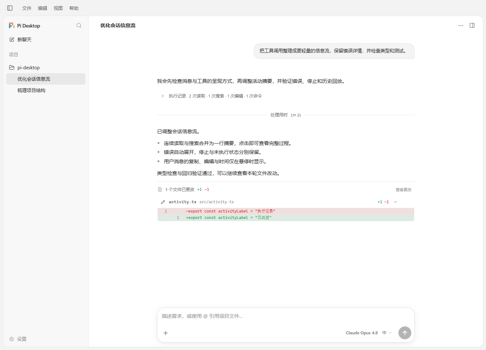
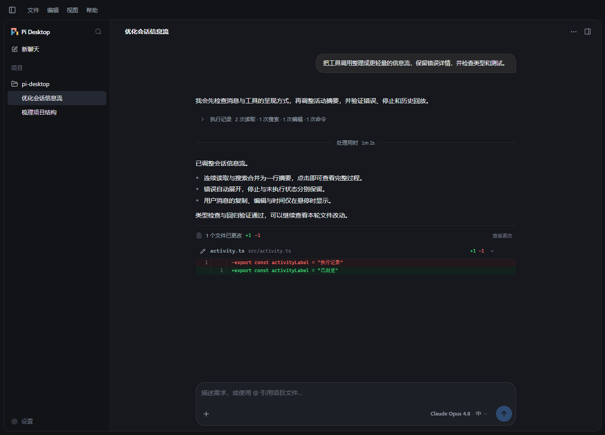
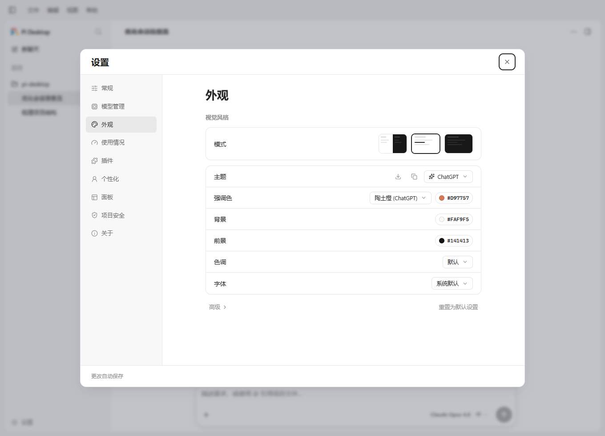

<div align="center">


# Pi Desktop

**为 Pi coding agent 打造的桌面工作台**

在一个窗口里完成对话、代码修改、Git 审查与终端操作。

[](https://github.com/facron2004/pi-desktop/releases/latest) [](https://github.com/facron2004/pi-desktop/releases/latest) [](https://github.com/earendil-works/pi) [](package.json) [](package.json) [](package.json) [](LICENSE)

[下载](https://github.com/facron2004/pi-desktop/releases/latest) · [快速上手](#快速上手) · [使用指南](docs/user-guide.md) · [开发文档](docs/development.md) · [更新日志](CHANGELOG.md)

</div>



<p align="center"><sub>v0.3.0 实际应用截图；对话与项目内容为演示数据。</sub></p>

## 简介

Pi Desktop 是 [Pi coding agent](https://github.com/earendil-works/pi) 的独立 Electron 图形客户端，通过 RPC 协议驱动 Pi。它提供接近 Codex 的桌面布局，同时保留 Pi 的模型、工具、会话树、技能与扩展能力。

## 核心功能

| 能力 | 说明 |
| --- | --- |
| 会话信息流 | 流式显示回复与工具过程，连续操作合并摘要，思考和输出按需展开，错误详情自动展开。 |
| 项目与历史 | 按项目组织会话，支持搜索、重命名、置顶、HTML 导出、会话树和从消息处重开分支。 |
| Git 工作流 | 查看分支、工作区与逐文件差异，暂存、提交、回退改动，管理分支和 worktree。 |
| 文件与终端 | 文件名及全文搜索、语法高亮、图片预览、内置终端和网页查看。 |
| 模型与上下文 | 选择 Pi 提供的模型和推理强度，查看上下文占用，支持压缩、任务引导与后续消息排队。 |
| 外观与扩展 | 简体中文与英文、深浅主题、字体和颜色配置、本地用量统计、MCP 配置查看及扩展对话框。 |

<details>
<summary>更多界面：深色工作台与外观设置</summary>

### 深色工作台



### 外观设置



</details>

## 下载与安装

当前发布版本为 **v0.3.0**，内置 **Pi 1.4.0**。安装版与免安装版均无需额外安装 Node.js 或 Pi CLI。

| 平台 | 下载 |
| --- | --- |
| Windows x64 安装版 | [下载 EXE](https://github.com/facron2004/pi-desktop/releases/download/v0.3.0/Pi-Desktop-0.3.0-x64-setup.exe) |
| Windows ARM64 安装版 | [下载 EXE](https://github.com/facron2004/pi-desktop/releases/download/v0.3.0/Pi-Desktop-0.3.0-arm64-setup.exe) |
| Windows x64 免安装版 | [下载 ZIP](https://github.com/facron2004/pi-desktop/releases/download/v0.3.0/Pi-Desktop-0.3.0-portable-x64.zip) |

免安装版解压后运行 `Pi Desktop.exe`。文件校验值见 [SHA256SUMS.txt](https://github.com/facron2004/pi-desktop/releases/download/v0.3.0/SHA256SUMS.txt)，版本说明见 [v0.3.0 更新说明](docs/releases/v0.3.0.md)。

## 快速上手

1. 启动应用，打开希望 Pi 处理的项目文件夹。
2. 准备好模型供应商认证；已有的 Pi 登录或配置可复用。在「设置 → 模型管理」检查认证并选择模型，配置方式见 [认证说明](docs/user-guide.md#模型与认证)。
3. 输入任务，或用 `@` 引用项目文件，发送后查看回复与工具过程。
4. 在工具面板查看文件和 Git 更改，确认后再提交需要保留的修改。

重启应用会恢复上次的项目并进入新聊天；点击侧栏中的历史会话后才会继续该会话。Pi 使用当前用户的权限执行操作，项目配置与扩展的加载可在设置中控制。

## 常用快捷键

| 快捷键 | 操作 |
| --- | --- |
| `Ctrl+N` | 新聊天 |
| `Ctrl+Shift+P` | 命令启动器 |
| `Ctrl+F` | 搜索当前会话 |
| `Ctrl+P` / `Ctrl+T` | 切换模型 / 推理强度 |
| `` Ctrl+` `` | 打开终端 |
| `Ctrl+/` | 查看完整快捷键列表 |

更多操作见 [使用指南](docs/user-guide.md)。

## 本地开发

需要 **Node.js 22.19+** 与 npm。

```bash
git clone https://github.com/facron2004/pi-desktop.git
cd pi-desktop
npm ci
npm run dev
```

构建、测试、打包与协议约定见 [开发文档](docs/development.md)，提交修改前请阅读 [AGENTS.md](AGENTS.md)。

## 反馈与许可

遇到问题可提交 [Issue](https://github.com/facron2004/pi-desktop/issues)，并附应用版本、操作系统、复现步骤与已脱敏的截图或日志。

项目采用 [MIT 许可证](LICENSE)。感谢 [Pi](https://github.com/earendil-works/pi) 及其贡献者；Pi Desktop 是独立的社区客户端。
