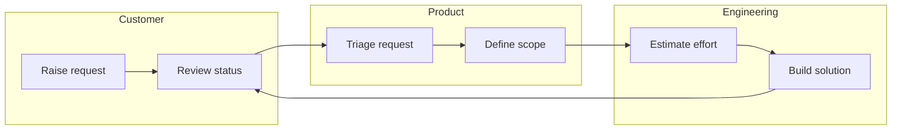
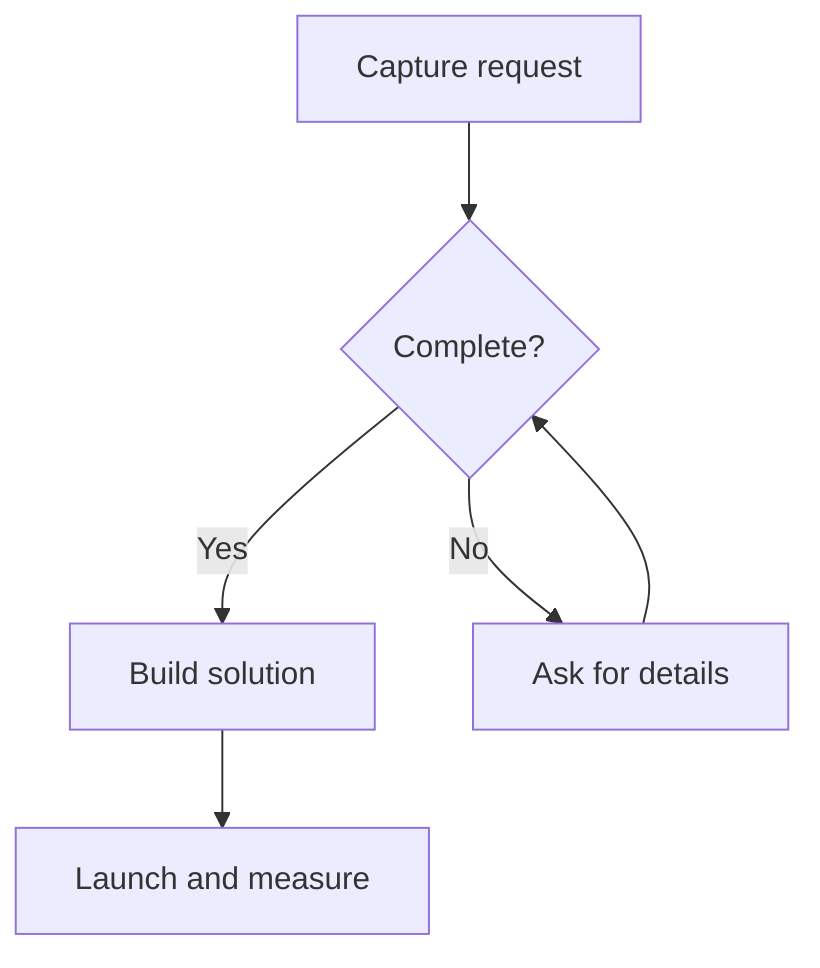
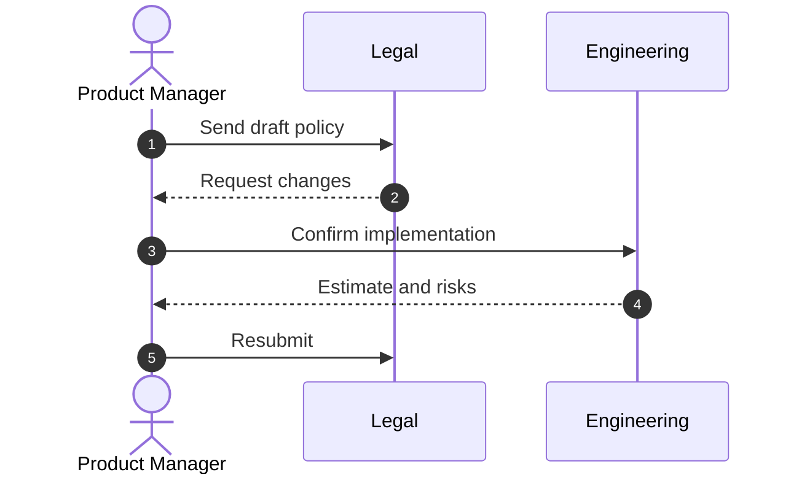
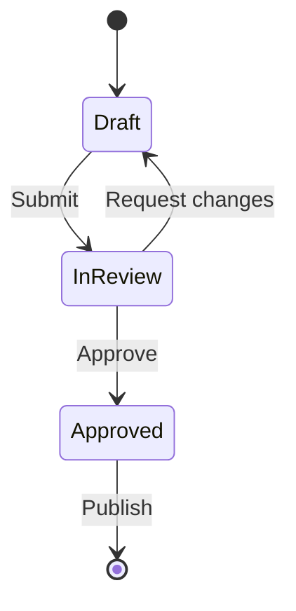
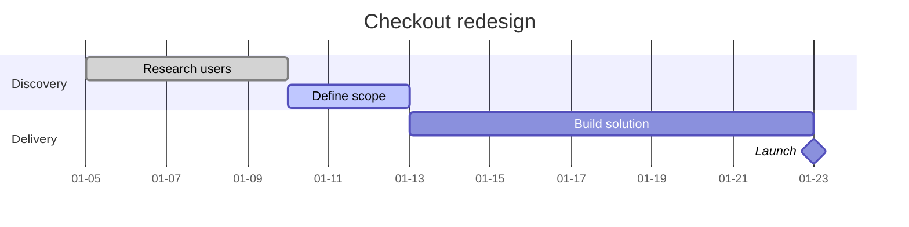
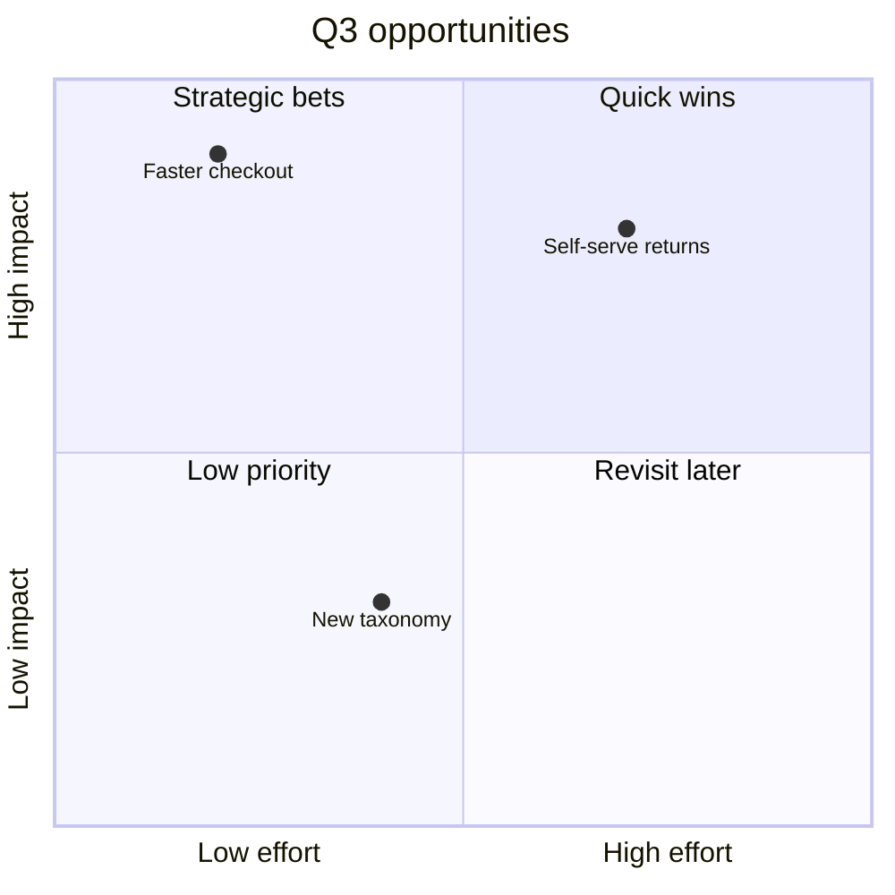
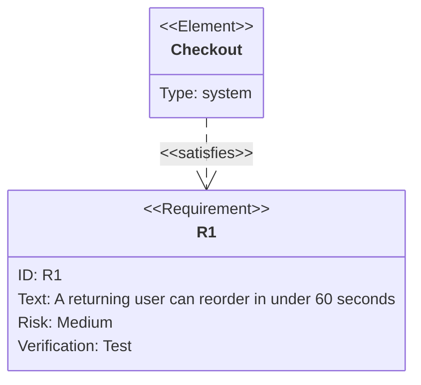

# Mermaid diagrams for product managers

A diagram is a decision tool, not decoration. Aim for the smallest diagram that answers the question the reader actually has.

## Workflow

1. **Name the question** the diagram must answer: "Where does a request get stuck?", "Who owns each hand-off?", "What states can this ticket be in?", "What ships when?".
2. **Pick the smallest type** from the table below.
3. **Start from a template.** Call the `mermaid` tool with `action=template` and the matching id. Replace every placeholder with the user's vocabulary; do not leave generic text.
4. **Draft in plain language first.** Write the nodes as short verb-first labels, then add branches and hand-offs.
5. **Validate before presenting.** Call the `mermaid` tool with `action=check` and the complete source. Fix every error it reports — the error includes the line and a concrete fix.
6. **Present the final source** in a ` ```mermaid ` code block, followed by 2–4 bullets explaining the takeaway.

## Choose the diagram type

| Id | Type | Use it when | Avoid it when |
|---|---|---|---|
| `flowchart` | Flowchart | You need steps, a decision, or a retry loop | The process crosses many teams — use a swimlane |
| `swimlane` | Swimlane | Ownership and hand-offs matter more than the steps themselves | There is only one actor |
| `sequence` | Sequence | Messages, approvals or API calls happen in a time order | The reader only needs the happy-path stages |
| `state` | State | An item moves through statuses with allowed transitions | The flow is a straight line |
| `journey` | User journey | You want to show experience, emotion and pain points per stage | You need precise timings or owners |
| `gantt` | Gantt | Dates, dependencies and milestones drive the plan | The plan is not date-based |
| `mindmap` | Mindmap | You are exploring scope, themes or a problem tree | The reader needs a sequence |
| `timeline` | Timeline | You are telling a milestone story by quarter or phase | Tasks have dependencies — use gantt |
| `quadrant` | Quadrant | You are prioritising on two named axes | There are more than two decision dimensions |
| `requirement` | Requirement diagram | You need requirement, risk and verification method together | A simple checklist is enough |
| `kanban` | Kanban | You are showing the current shape of a delivery board | You need dates |
| `architecture` | Architecture | You need services, groups and system boundaries for a product audience | You are documenting code-level detail |
| `pie` | Pie | You need one simple proportion | There are more than about six slices |

## The swimlane pattern

A swimlane is a `flowchart` with one `subgraph` per lane. Keep each lane's own steps flowing in one direction, and make every cross-lane edge a deliberate hand-off.



Rules that keep swimlanes readable:

- One lane per **owner**, not per system or per phase.
- Lane names are nouns: `Customer`, `Product`, `Engineering`, `Support`.
- Every edge that crosses a subgraph boundary is a hand-off — label it with the artifact or decision that moves (`|Spec approved|`).
- Use `flowchart LR` when you want the reader to scan left to right; `TD` when lanes are long and vertical scanning is easier.
- Keep lanes at roughly the same height. A lane with twelve steps and another with one means the model is wrong, not the drawing.

## Syntax pitfalls that break real diagrams

- **Quote labels with punctuation.** `A[Review (draft)]` fails; write `A["Review (draft)"]`. Quote anything containing `()[]{}<>:;,.!?` or a dash — especially Chinese labels with full-width punctuation.
- **Close every `subgraph` with `end`.** One missing `end` usually produces an error far away from the actual mistake. Count subgraphs and `end` lines.
- **No raw `<` or `>` inside labels.** Write `less than 5 seconds` or `under 5s`, not `<5s`.
- **Do not use a semicolon to chain statements.** Put each statement on its own line; it is easier to read and easier to validate.
- **Keep node ids short and stable.** Use `A`, `B`, `P1`, `E2`; put the readable text inside the label.
- **Do not put Markdown inside labels.** Bold, links and backticks do not render inside a Mermaid node.
- **Gantt needs `dateFormat`.** Put `dateFormat YYYY-MM-DD` directly under `gantt`, before the first task.
- **Sequence needs a real message arrow.** `A->>B: request` or `A-->>B: response`; a list of participants alone is not a diagram.
- **Requirement blocks need braces.** `requirement R1 { ... }` with `id`, `text`, `risk` and `verifymethod`.
- **Chinese text is fine.** Keep labels short, quote punctuation, and avoid mixing full-width brackets with Mermaid's own brackets.

## Compact examples

### 1. Flowchart with a decision and a retry loop



### 2. Sequence for an approval flow



### 3. State lifecycle with a rejection path



### 4. Gantt with a dependency and a milestone



### 5. Quadrant for prioritisation



### 6. Requirement and verification



## Visual style

The host application owns the palette; a diagram should look like part of the product, not a rainbow.

- Let the theme colour normal nodes. Do not add `classDef` fills unless the user asks for a status colour or a risk callout.
- Use one accent for decisions and exceptions, neutral surfaces for normal steps, and at most one extra colour for a risk or blocked path.
- Prefer rounded rectangles for steps, diamonds only for decisions, and circles or stadium shapes only for start/end. Do not mix every shape into one diagram.
- Keep subgraph headers as short nouns and let whitespace separate lanes; do not draw borders around every idea.
- No emoji or decorative icons in node labels. One diagram should read at a glance, even in a narrow chat column.
- Do not hand-write CSS, `style` or `%%{init}%%` blocks; the renderer supplies the visual system and the user's theme.

## Product-manager quality checklist

Before presenting a diagram, confirm all of these:

- [ ] The diagram answers one named question.
- [ ] The type is the smallest one that answers it.
- [ ] Every node label starts with a verb and fits on one line.
- [ ] There are at most ~20 nodes; if more, split the diagram.
- [ ] Every decision branch is labelled (`|Yes|`, `|No|`, `|Needs review|`).
- [ ] Every cross-team arrow is a hand-off with a named artifact or decision.
- [ ] The happy path is obvious without reading every label.
- [ ] Failure, rejection or retry paths are shown when they change the outcome.
- [ ] Labels use the audience's vocabulary, not internal codenames.
- [ ] Chinese or mixed-language labels are quoted when they contain punctuation.
- [ ] `subgraph` and `end` lines are balanced.
- [ ] The source passed `mermaid` action=check with no errors.
- [ ] The answer includes a short takeaway, not only the diagram.
